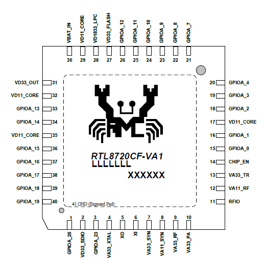
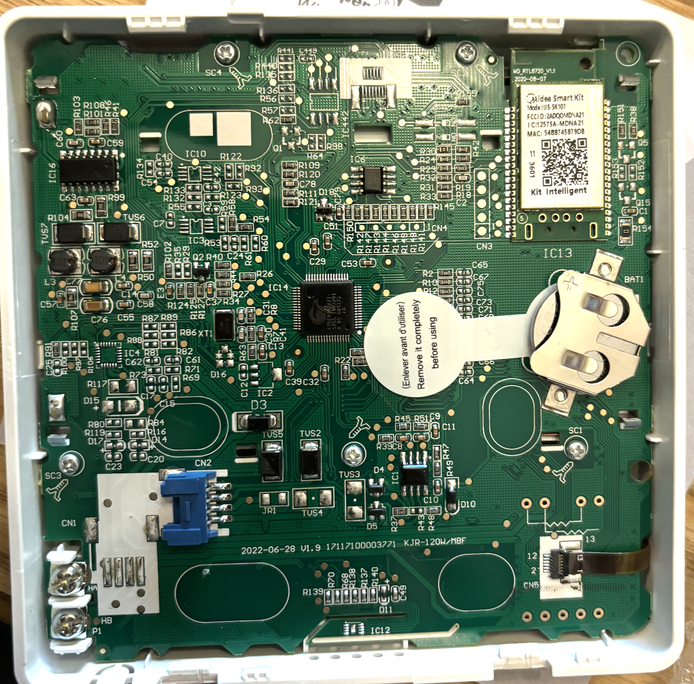
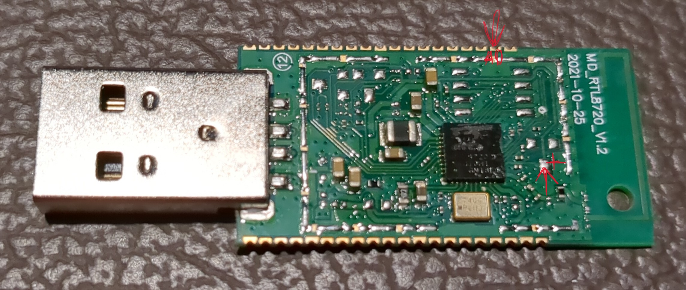

# midea-sk105-esphome
How to get the stock Midea SK105 working with ESPHome. 

*Note: These commands were done on Debian 13, YMMV if using a different OS.*

### Hardware
The Midea Smart Kit SK105 module found in many Midea AC units is based around the RTL8720C.



It appears that this module was designed to be installed both as a USB device:


> Thanks [dhewg](https://github.com/libretiny-eu/ltchiptool/issues/18#issue-2100959732)!

or also soldered directly onto a PCB:


> Thanks [timmerk](https://github.com/libretiny-eu/ltchiptool/issues/18#issuecomment-6106473171)!

The nice part about these modules is that all the necessary pins are exposed for our uses. Multiple `GND`, `5v`, pin `A0`, and both pairs of UART (`AC_UART` for communication with the AC MCU, `LOG_UART` for logs and flashing) are accessible via test point pads on the top and bottom of the module, and all are mapped to the castellated pads.

### Reading Firmware
The first thing I did was read and backup the stock firmware. To do this, the device must be put into download mode. This is achieved by holding pin `A0` to 3.3v momentarily during boot. Pin A0 is exposed in 3 locations, 2 of them accessible from the top:


> Thanks [panzerknacker20111](https://github.com/libretiny-eu/ltchiptool/issues/18#issuecomment-2923657454)!

and the third location being the test point on the bottom labelled `CLK`; I held `A0` via `CLK` using the 3.3v from my serial adapter. First hold pin `A0` at 3.3v, then connect the board to power. I powered mine from the test pads near the USB on the bottom labelled `5v` and `GND` from a benchtop power supply. I held `A0` for only about a second and that seemed to work. After the device is in download mode, run `ltchiptool flash read realtek-ambz2 sk105_stock.bin`. A copy of the firmware dump is available [here](./sk105_stock_firmware_dump.bin).

### Patching ESPHome

### Example ESPHome YAML
[This](./esphome/sk105-example.yaml) is a generalized version of the YAML that I flashed my SK105 with:

```yaml
esphome:
  name: sk105
  friendly_name: SK105
  platformio_options:
    lib_compat_mode: "off"   # MideaUART's manifest only declares Espressif

rtl87xx:
  board: generic-rtl8720cf-2mb-992k   # some SK10x might be 896k; match the stock partition layout

external_components:
  - source:
      type: local
      path: components
    components: [midea]

logger:

api:
  encryption:
    key: !secret sk105__encryption_key

ota:
  - platform: esphome
    password: !secret sk105__ota_password

wifi:
  ssid: !secret wifi_ssid
  password: !secret wifi_password
  ap:
    ssid: SK105 Fallback Hotspot
    password: !secret sk105__ota_password

captive_portal:

uart:
  tx_pin: PA14
  rx_pin: PA13
  baud_rate: 9600

climate:
  - platform: midea
    name: Midea AC
    autoconf: true

```

### Flashing Firmware
Flashing is as simple as entering download mode as mentioned above (hold `A0` at 3.3v during boot), and then running `ltchiptool flash write firmware.uf2`.